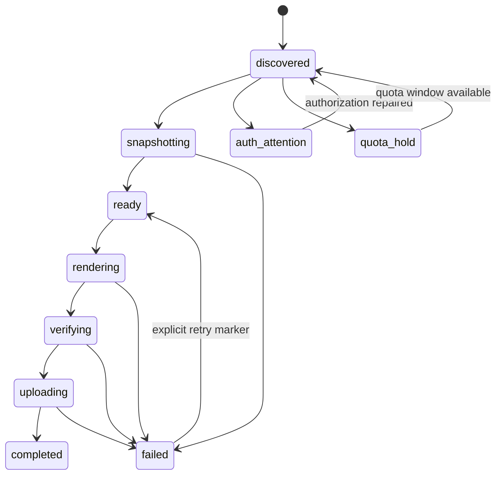

# TTS_gen Automation Contract

Status: **approved for implementation on 2026-11-17 by the repository owner's
request to complete the TaskList**. External-service and Windows Scheduler
acceptance remain manual gates and must not be represented as completed until
the checks in this document are run with the owner's accounts.

## Decisions and phase gates

- Full chapters remain 1080x1920 at 30 fps. Dimensions are configurable, but
  this is the supported acceptance profile.
- Phase 0 is a local-only, explicitly selected workflow. `render_chapter.py --job-dir`
  processes one frozen job directory and never scans Drive.
- From Phase 1 onward, Drive is the control plane and the only scheduled entry
  point is `run_drive_queue.py --once`.
- Phase 2 (Gemini/Langflow planning) and Phase 3 (vertical teaser) are opt-in.
- Upload to public video platforms is always a manual terminal step.
- A requested teaser failure fails the job; it is never silently omitted.

## Privacy and authorization boundaries

The implementation is authorized, but no external call is authorized merely by
running a unit test. Operators must deliberately supply configuration before
unpublished manuscript text leaves the machine.

- Drive input access uses `drive.readonly`; output uses `drive.file`. The broad
  read scope and manuscript upload must be approved by the account owner during
  OAuth consent.
- Gemini/Langflow egress is disabled unless `ENABLE_GEMINI_PLANNING=true`. The
  operator is responsible for accepting the configured Gemini tier's current
  data-use terms before enabling it.
- OAuth must use a Production consent screen for unattended operation. A
  Testing-mode client requires documented reauthorization at least every seven
  days and is not production-ready.
- OAuth client JSON and tokens live in `%LOCALAPPDATA%\TTS_gen\secrets`, never
  in the repository. API keys come from the environment, must be restricted to
  the required API where supported, rotated after suspected disclosure, and
  redacted from logs and exceptions.
- Official Google libraries are required. Reimplementing OAuth refresh and
  resumable Drive uploads with stdlib `urllib` would omit mature token,
  transport, retry, and session handling.

## Job identity and snapshot contract

The job fingerprint is SHA-256 over UTF-8 lines sorted by Drive file ID, each
line exactly `fileId\0modifiedTime\0md5Checksum-or-empty\0size-or-empty\n`.
Native Google Docs use an empty checksum. After download/export, the queue
re-reads metadata and accepts the snapshot only if the fingerprint is unchanged.
Changed input is a new job version and never mixes with an existing snapshot.

Google Docs export as `text/plain`; normalize CRLF to LF, trim outer whitespace,
split paragraphs on one or more blank lines, preserve paragraph text verbatim,
and number paragraphs only in planner requests (not in saved `chapter.txt`).

## Timeline and recovery contract

Timelines are strict: no unknown fields, scenes are contiguous within one 30 fps
frame, every image remains inside the job's image directory, and total video
duration matches narration within one frame. Supported motion values are
`static`, `push_in`, `pull_out`, `pan_left`, and `pan_right`.

SQLite is authoritative. A verified local MP4 is reused for upload retry.
Generated Drive IDs are persisted before upload and queried before retry. The
default maximum is three attempts. Failed workspaces and raw model output are
retained. Requeue requires a human-created `RETRY` marker. The process lock and
Task Scheduler's no-overlap setting are both mandatory.

## Gemini quota policy

The 80% gate is a local safety policy, not a provider guarantee. Current RPM,
TPM, RPD, and other limits must be configured from the project's dashboard.
Input estimation uses `countTokens`; reservations and reconciliation are stored
transactionally. The ledger sees only this automation, so a dedicated project
is recommended. Missing limits or usage metadata produces `quota_hold`.

Before enabling Phase 2, a human must record a real redacted spike under
`DOCS/spikes/` showing the chosen model, `countTokens`, actual usage metadata,
Langflow response path, RPM/TPM/RPD limits, and whether reconciliation is done
by flow instrumentation or a direct API call.

## Acceptance boundaries

Automated tests may prove local behavior with fakes and local media. The
following remain manual: install FFmpeg/FFprobe for the scheduled account;
OAuth consent; real Drive, Gemini, and Langflow calls; privacy approval; Task
Scheduler registration; playback/editorial review; and public upload.

